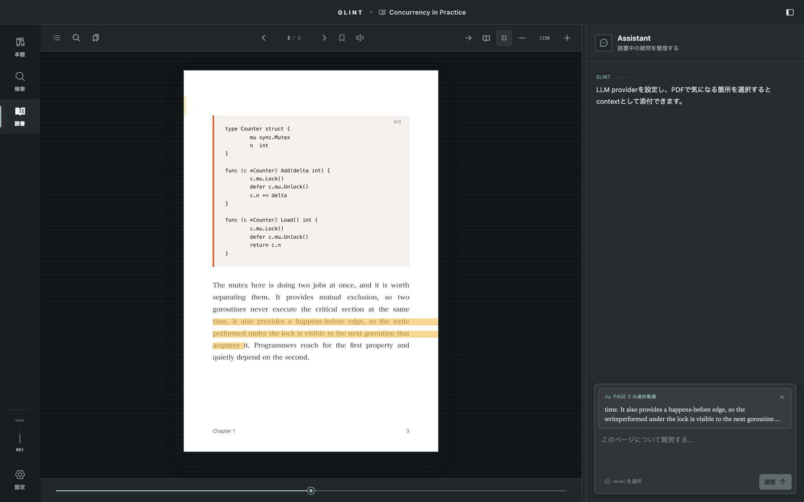

# Glint

[English](README.md) | **日本語**

Glint は技術書を読むための desktop app です。PDF を開き、目次・しおり・見開き・全文検索といった reader として当然の機能で読み進めながら、いま開いているページについて本から離れずに AI へ質問できます。

本も読書位置も API key も、すべて手元のマシンに残ります。自分で質問に添付しない限り、AI provider へは何も送られません。



## できること

### 手元の本棚に置く


- macOS の file picker から技術書を追加する（PDF、および検索用の EPUB）。
- import した本を表紙付きで本棚に並べ、前回読んでいたページから再開する。
- 自分が呼んでいる名前に変更したり、本棚から削除したりする。
- 元のファイルを移動・削除した場合は Glint が知らせ、ファイルを選び直せる。

### 読む

- PDF を単ページでも見開きでも読む。
- 左綴じ / 右綴じを切り替えられるので、日本語の本も正しい向きでめくれる。
- 拡大・縮小、ウィンドウ幅に合わせる。
- 目次、page slider、ページ番号の直接入力で移動する。
- ページにしおりを挟み、しおり一覧から戻る。
- 現在のページを読み上げる。ページの終わりで次のページへ自動で進む。
- light / dark / system に合わせた表示で読む。ページそのものは著者が作ったままの見た目を保つ。
- Glint の UI を英語または日本語で使う。

### 探す

- 読んでいる本の中を `⌘F` で検索し、該当ページへ飛ぶ。
- import 済みのすべての本を横断検索し、目的の本の目的のページを開く。

### 読みながら質問する

- chat sidebar がページの隣にあるので、質問しても本から離れない。
- ページ上のテキストを選択して質問に添付する。context なしで質問することもできる。
- 添付した context は送信前に表示されるので、何が手元から出ていくかが常に分かる。
- 回答は生成されながら streaming で表示され、途中で中断できる。
- 使う model は設定画面を開かずに composer から会話ごとに切り替えられる。

### 好きな model を使う

Glint は選んだ provider と通信します。

- OpenRouter
- OpenAI
- Anthropic
- Google Gemini
- Ollama（ローカルで動作、API key 不要）
- 自分で追加した OpenAI 互換の endpoint

provider を設定していなくても本棚・reader・検索は使えます。provider が必要なのは AI 機能だけです。

### EPUB の現状

EPUB は import と検索ができ、他の本と同じように本棚へ並びます。ただし EPUB の閲覧画面は制作中のため、開くと現時点では placeholder が表示されます。PDF は今すぐ読めます。

## 使い始める

Glint は macOS 13 以降で動きます。

### Homebrew でインストールする

```bash
brew install --cask ktsu2i/tap/glint
```

Glint はまだ Apple の notarization を受けていないため、初回起動は macOS にブロックされます。システム設定 > プライバシーとセキュリティ で「このまま開く」を押すか、次を実行してください。

```bash
xattr -dr com.apple.quarantine /Applications/Glint.app
```

[GitHub Releases](https://github.com/ktsu2i/glint/releases) から zip を直接ダウンロードすることもできます。

### source から build する

必要なもの:

- Go 1.27.4 以上
- Node.js 26（26.13.1 以上）
- pnpm 12.21.0
- Wails CLI v2.17.1

これらのバージョンは `mise.toml` で固定しています。[mise](https://mise.jdx.dev) を使う場合は `mise install` でまとめて入ります。使わない場合は Wails CLI を自分で install します。

```bash
go install github.com/wailsapp/wails/v2/cmd/wails@v2.17.1
```

Wails が追加のツールを要求することがあります。build が失敗する場合は [Wails installation guide](https://wails.io/docs/gettingstarted/installation) を確認してください。

build します。

```bash
cd frontend
pnpm install --frozen-lockfile
cd ..
wails build
```

`build/bin/Glint.app` が生成されます。アプリケーションフォルダへ移動すれば、通常の Mac アプリと同じように開けます。

## AI provider を設定する

1. sidebar から **Settings** を開く。
2. **LLM Providers** で provider を選び、API key を貼り付ける。Ollama は API key 不要で、ローカルの endpoint を使う。
3. 一覧にない OpenAI 互換のサービスを使う場合は **Add OpenAI-compatible endpoint** を選び、Base URL、任意の API key、必要な custom headers を入力する。
4. **Test connection** で、key と model が実際に使えることを事前に確認する。
5. reader に戻り、chat composer の model selector から使う provider と model を選ぶ。

## 手元から出ていくもの

- **本は出ていきません。** PDF、EPUB、表紙、読書位置、しおりはすべて Mac のローカルに保存されます。
- **送るのは、送ったものだけです。** 質問と、明示的に添付したページのテキストだけが選択した provider へ送られます。それ以外は送信されず、送信ボタンを押すまでは何も送られません。
- **API key は OS の credential store に保存されます。** Glint 自身の database には保存されず、一度保存した key が画面に読み戻されることはありません。
- **OpenRouter への request は zero-data-retention endpoint に固定されます。** prompt を保持する provider へ routing されません。
- 組み込み provider の endpoint、API version、認証方式は Glint が管理するため、設定を誤る余地がありません。

## これから向かう先

読むことと質問できることは土台です。目指しているのは、本と自分のコードをつなぐ reader です。自分のリポジトリを Glint に指定すると、いま読んでいる章から、それが説明しているファイル・symbol・パターンへ辿れる。しかも本とコードの両方に根拠を示した状態で。この機能は制作中で、まだアプリには含まれていません。

## 開発する

Glint は Wails v2、Go、React 19 + TypeScript、PDF.js、SQLite で作られています。source から live reload 付きで起動するには、上記の必要環境を入れたうえで次を実行します。

```bash
cd frontend
pnpm install --frozen-lockfile
cd ..
wails dev
```

frontend の package manager は pnpm 12.21.0 に固定しています。`npm install` と `npm run` は意図的に失敗します。

テスト:

```bash
go test ./...
cd frontend
pnpm test
pnpm run build
```

### リリース

リリースは [tagpr](https://github.com/Songmu/tagpr) で管理しています。`main` に merge するたびに、tagpr がリリース PR を作成・更新します。この PR で `wails.json` と `frontend/package.json` のバージョンが上がり、merge された PR の一覧が `CHANGELOG.md` に追記されます。リリース PR を merge すると、tag が作られ、macOS の universal app がビルドされて GitHub Release に添付され、Release が公開されます。Homebrew tap は新しいバージョンを自動で取り込みます。

次のバージョンは、デフォルトでは patch が上がります。minor を上げたいときは PR に `enhancement`（または `minor`）ラベルを、major を上げたいときは `major` ラベルを付けてください。リリース PR に `tagpr:minor` / `tagpr:major` ラベルを付けるか、リリース PR 上で `wails.json` のバージョンを直接書き換えることもできます。
