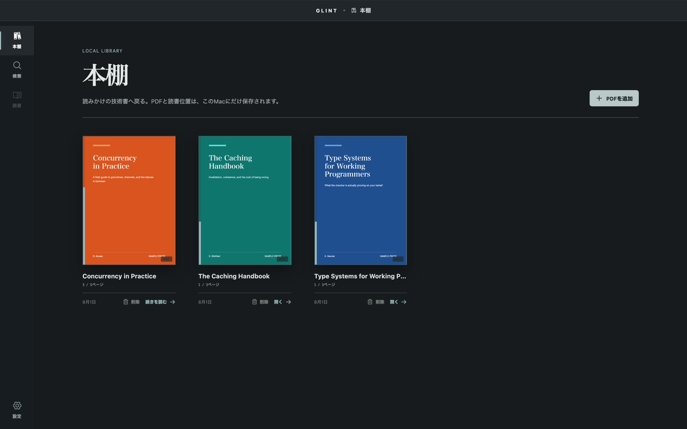

# Glint

[English](README.md) | **日本語**

Glint は技術書を読むための desktop app です。PDF を開き、目次・しおり・見開き・全文検索といった reader として当然の機能で読み進められます。

本も読書位置も、すべて手元のマシンに残ります。

## できること

### 手元の本棚に置く



- macOS の file picker から技術書を追加する（PDF、および検索用の EPUB）。
- import した本を表紙付きで本棚に並べ、前回読んでいたページから再開する。
- 自分が呼んでいる名前に変更したり、本棚から削除したりする。
- 元のファイルを移動・削除した場合は Glint が知らせ、ファイルを選び直せる。

### 読む

- PDF を単ページでも見開きでも読む。
- 左綴じ / 右綴じを切り替えられるので、日本語の本も正しい向きでめくれる。
- 拡大・縮小、ウィンドウ幅に合わせる。
- 目次、page slider、ページ番号の直接入力で移動する。
- ページにしおりを挟み、しおり一覧から戻る。
- 現在のページを読み上げる。ページの終わりで次のページへ自動で進む。
- light / dark / system に合わせた表示で読む。ページそのものは著者が作ったままの見た目を保つ。
- Glint の UI を英語または日本語で使う。

### 探す

- 読んでいる本の中を `⌘F` で検索し、該当ページへ飛ぶ。
- import 済みのすべての本を横断検索し、目的の本の目的のページを開く。

### EPUB の現状

EPUB は import と検索ができ、他の本と同じように本棚へ並びます。ただし EPUB の閲覧画面は制作中のため、開くと現時点では placeholder が表示されます。PDF は今すぐ読めます。

## 使い始める

Glint は macOS 13 以降で動きます。

### Homebrew でインストールする

```bash
brew install --cask ktsu2i/tap/glint
```

Glint はまだ Apple の notarization を受けていないため、初回起動は macOS にブロックされます。システム設定 > プライバシーとセキュリティ で「このまま開く」を押すか、次を実行してください。

```bash
xattr -dr com.apple.quarantine /Applications/Glint.app
```

[GitHub Releases](https://github.com/ktsu2i/glint/releases) から zip を直接ダウンロードすることもできます。

### アップデート

Glint は [Sparkle](https://sparkle-project.org/) を使って、1日1回アップデートを確認します。新しいバージョンがあるとインストールを案内するウィンドウが開き、インストールすると新しいバージョンで再起動します。メニューバーの Glint > Check for Updates… から手動で確認することもできます。確認のときに GitHub に問い合わせるのは最新のリリースだけで、本やリポジトリの情報は送りません。

アップデートは、インストールする前に EdDSA 署名で検証されます。「このまま開く」で起動して quarantine 属性が残っている場合、macOS が Glint を読み取り専用の場所から起動し、自分でアップデートできないことがあります。その場合は、上の `xattr` コマンドを一度実行してください。

### source から build する

必要なもの:

- Go 1.27.4 以上
- pnpm 12.21.0

ほかのツールはリポジトリで版を固定しているので、自分で install する必要はありません。

- 手元の Go が古い場合は、Go が `go.mod` の版の toolchain を自動で取得します。
- Wails CLI（v2.17.1）は `go.mod` の tool 依存です。`go tool wails` で実行します。
- frontend 用の Node.js 26.13.1 は、`frontend/package.json` の `devEngines.runtime` に従って pnpm が取得します。

Wails が追加のツールを要求することがあります。build が失敗する場合は [Wails installation guide](https://wails.io/docs/gettingstarted/installation) を確認してください。

build します。

```bash
cd frontend
pnpm install --frozen-lockfile
cd ..
go tool wails build
```

`build/bin/Glint.app` が生成されます。アプリケーションフォルダへ移動すれば、通常の Mac アプリと同じように開けます。

`.github/workflows` 配下の workflow を変更した場合は、CI と同じ検査を実行してください。ツールの版は `aqua.yaml` で固定しています。[aqua](https://aquaproj.github.io/) を使う場合は `aqua i -l` でまとめて入ります。

```bash
actionlint
jactionlint
ghalint run
zizmor .
```

## 手元から出ていくもの

- **本は出ていきません。** PDF、EPUB、表紙、読書位置、しおり、設定はすべて Mac のローカルに保存されます。
- **通信はアップデート確認だけです。** GitHub に最新のリリースを問い合わせるだけで、本の情報は送りません。

## これから向かう先

読むことは土台です。目指しているのは、本と自分のコードをつなぐ reader です。自分のリポジトリを Glint に指定すると、いま読んでいる章から、それが説明しているファイル・symbol・パターンへ辿れる。しかも本とコードの両方に根拠を示した状態で。この機能は制作中で、まだアプリには含まれていません。

## 開発する

Glint は Wails v2、Go、React 19 + TypeScript、PDF.js、SQLite で作られています。source から live reload 付きで起動するには、上記の必要環境を入れたうえで次を実行します。

```bash
cd frontend
pnpm install --frozen-lockfile
cd ..
wails dev
```

frontend の package manager は pnpm 12.21.0 に固定しています。`npm install` と `npm run` は意図的に失敗します。

テスト:

```bash
go test ./...
cd frontend
pnpm test
pnpm run build
```

frontend の静的チェック (型検査、oxlint、oxfmt、knip) はまとめて実行できます。

```bash
cd frontend
pnpm check      # typecheck + lint + format:check + knip
pnpm lint:fix   # 自動修正できる lint を直す
pnpm format     # oxfmt で整形する
```

### リリース

リリースは [tagpr](https://github.com/Songmu/tagpr) で管理しています。`main` に merge するたびに、tagpr がリリース PR を作成・更新します。この PR で `wails.json` と `frontend/package.json` のバージョンが上がり、merge された PR の一覧が `CHANGELOG.md` に追記されます。リリース PR を merge すると、tag が作られ、macOS の universal app がビルドされて GitHub Release に添付され、Release が公開されます。続けて [ktsu2i/homebrew-tap](https://github.com/ktsu2i/homebrew-tap) の update workflow を起動します。この workflow が cask のバージョンを上げ、インストールできることを確認してから merge するので、数分後には `brew upgrade --cask glint` で新しいバージョンが入ります。これには `HOMEBREW_TAP_TOKEN` secret (`ktsu2i/homebrew-tap` の Actions: write を持つ fine-grained PAT) が必要です。未設定の場合も、tap 側の定期実行 (1日2回) で取り込まれます。

release workflow は、[Sparkle](https://sparkle-project.org/) を組み込んで (`sparkle` build tag) Glint をビルドし、`SPARKLE_ED_PRIVATE_KEY` secret の EdDSA 鍵で zip に署名して、`appcast.xml` を Release に添付します。インストール済みの Glint は最新 Release の `appcast.xml` を読み、`build/darwin/Info.plist` の公開鍵で署名を検証します。秘密鍵は必ずバックアップしてください。失うと、インストール済みの Glint をアプリ内から更新できなくなります。

次のバージョンは、デフォルトでは patch が上がります。minor を上げたいときは PR に `enhancement`（または `minor`）ラベルを、major を上げたいときは `major` ラベルを付けてください。リリース PR に `tagpr:minor` / `tagpr:major` ラベルを付けるか、リリース PR 上で `wails.json` のバージョンを直接書き換えることもできます。
