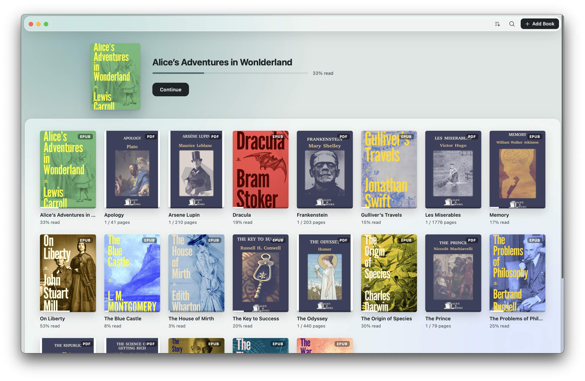

# Glint

**English** | [日本語](README.ja.md)

Glint is a desktop reading app for technical books. Open a PDF and read it the way you would in a proper reader — table of contents, bookmarks, spreads, full-text search.

Your books and your reading positions stay on your machine.

## What you can do

### Keep a local library



- Add technical books from your Mac with the native file picker (PDF, and EPUB for search).
- See every imported book on a shelf with its cover, most recently read first, and click a cover to pick up exactly where you stopped.
- Right-click a book to rename it to whatever you actually call it, or to remove it from the shelf.
- If you move or delete the original file, Glint tells you and lets you point it at the file again from its cover.

### Read

- Read with the page in front and the controls out of the way. Click the page or press `Esc` to show or hide the floating toolbar and page slider.
- Read PDFs page by page, or as two-page spreads.
- Switch between left-side and right-side binding, so Japanese books turn the right way.
- Zoom in and out, or fit the page to the window. The layout, binding, and zoom live in the `Aa` menu.
- Jump around with the table of contents, the page slider, or by typing a page number.
- Bookmark pages and return to them from the bookmarks panel.
- Select text to highlight it in yellow, green, blue, or pink, and look back over every highlight in the highlights panel. Click a highlight on the page to remove it.
- Have the current page read aloud, with automatic advance to the next page.
- Read in light or dark mode, or follow your system setting. The page itself stays as the author made it.
- Use Glint in English or Japanese. Both settings live in the Settings window (`⌘,`).

### Search

- Search inside the book you are reading with `⌘F` and jump to any matching page.
- Search across every book you have imported from the library with `⌘F`, and open the right book at the right page.
- Find a book by its title in the same library search. Matching titles and pages both appear as you type.

### EPUB, for now

EPUB files can be imported and searched from the library, and they appear on your shelf like any other book. The EPUB reading view is still being built, so opening one shows a placeholder for the moment. PDFs are fully readable today.

## Getting started

Glint runs on macOS 13 or later.

### Install with Homebrew

```bash
brew install --cask ktsu2i/tap/glint
```

Glint is not notarized by Apple yet, so macOS blocks the first launch. Open System Settings > Privacy & Security and click "Open Anyway", or run:

```bash
xattr -dr com.apple.quarantine /Applications/Glint.app
```

You can also download the zip from [GitHub Releases](https://github.com/ktsu2i/glint/releases).

### Updates

Glint checks for updates once a day with [Sparkle](https://sparkle-project.org/). When a new version is out, a window offers to install it, and Glint restarts on the new version. You can also choose Glint > Check for Updates… from the menu bar. The check only asks GitHub for the latest release and sends nothing about your books or repositories.

Updates are verified with an EdDSA signature before they are installed. If Glint was opened with "Open Anyway" and still carries the quarantine attribute, macOS may run it from a read-only location where it cannot update itself. Run the `xattr` command above once to fix this.

### Build from source

You need:

- Go 1.27.4 or newer
- pnpm 12.21.0

The other tools are pinned in the repository, so you don't install them yourself:

- Go fetches the toolchain version in `go.mod` when yours is older.
- The Wails CLI (v3.1.0) is a tool dependency in `go.mod`. Run it with `go tool wails3`.
- sqlc (v1.31.1) is a tool dependency in `go.mod` too. Run it with `go tool sqlc`.
- pnpm downloads Node.js 26.13.1 for the frontend, as `devEngines.runtime` in `frontend/package.json` asks.

Wails may need a few extra system tools; see the [Wails installation guide](https://wails.io/getting-started/installation/) if the build complains.

Then build the app:

```bash
cd frontend
pnpm install --frozen-lockfile
cd ..
go tool wails3 build
```

The build runs the tasks in `Taskfile.yml`: install frontend dependencies, generate bindings, build the frontend, and package/sign the macOS app. Use `go tool wails3 task build ARCH=universal` for both Apple Silicon and Intel. The bundle version comes from `frontend/package.json`; Sparkle settings and the bundle identifier stay in `build/darwin/Info.plist`.

The finished app lands at `build/bin/Glint.app`. Move it to your Applications folder and open it like any other Mac app.

If you change the workflows under `.github/workflows`, run the same checks as CI. The tools are pinned in `aqua.yaml`; with [aqua](https://aquaproj.github.io/), `aqua i -l` sets them up:

```bash
actionlint
jactionlint
ghalint run
zizmor .
```

If you change Go code, run golangci-lint as CI does. It is pinned in `aqua.yaml` too, and the settings live in `.golangci.yml`:

```bash
golangci-lint run ./...
golangci-lint fmt ./...
```

Database queries live in `internal/library/queries/*.sql`, and sqlc generates the Go code in `internal/library/librarydb` from them and `migrations/`. If you change a query or add a migration, regenerate the code and commit it. CI runs `go tool sqlc diff` to catch stale code:

```bash
go tool sqlc generate
```

## What leaves your machine

- **Your books never leave.** PDFs, EPUBs, covers, reading positions, bookmarks, highlights, and settings are stored locally on your Mac.
- **The only network request is the update check.** It asks GitHub for the latest release and sends nothing about your books.

## Where Glint is going

Reading is the foundation. The goal is a reader that connects a book to your own code: point Glint at one of your repositories, and go from a chapter you are reading to the files, symbols, and patterns in your codebase that it describes — with citations back to both the book and the code. That work is in progress and not part of the app yet.

## Working on Glint

Glint is built with Wails v3, Go, React 19 + TypeScript, PDF.js, and SQLite. To run it from source with live reload, install the prerequisites above, then:

```bash
cd frontend
pnpm install --frozen-lockfile
cd ..
go tool wails3 dev
```

Development mode uses `build/config.yml` and launches `build/bin/Glint.dev.app` with a Vite server. Generated bindings live in `frontend/bindings` and are not committed; generate them before running frontend checks on a fresh checkout (CI does this too).

The frontend is pinned to pnpm 12.21.0; `npm install` and `npm run` fail by design.

Tests:

```bash
go test ./...
go tool wails3 generate bindings -ts -i
cd frontend
pnpm test
pnpm run build
```

Run all frontend static checks (type check, oxlint, oxfmt, knip) at once.

```bash
cd frontend
pnpm check      # typecheck + lint + format:check + knip
pnpm lint:fix   # apply autofixable lint fixes
pnpm format     # format with oxfmt
```

### Releasing

Releases are managed by [tagpr](https://github.com/Songmu/tagpr). After each merge to `main`, tagpr opens or updates a release PR. The PR bumps the version in `frontend/package.json` and adds the merged pull requests to `CHANGELOG.md`. Merging the release PR tags the release, builds the universal macOS app, attaches it to the GitHub release, and publishes the release. The workflow then triggers the update workflow in [ktsu2i/homebrew-tap](https://github.com/ktsu2i/homebrew-tap), which bumps the cask, checks that it installs, and merges the change, so `brew upgrade --cask glint` sees the new version within a few minutes. This needs the `HOMEBREW_TAP_TOKEN` secret, a fine-grained PAT with Actions: write on `ktsu2i/homebrew-tap`. Without it, the tap still picks up the release on its scheduled run twice a day.

The release workflow also builds Glint with [Sparkle](https://sparkle-project.org/) (the `sparkle` build tag), signs the zip with the EdDSA key in the `SPARKLE_ED_PRIVATE_KEY` secret, and attaches `appcast.xml` to the release. Installed copies read `appcast.xml` from the latest release and verify the signature with the public key in `build/darwin/Info.plist`. Keep a backup of the private key: without it, installed copies cannot be updated from inside the app.

The next version is a patch bump by default. Label a pull request `enhancement` (or `minor`) for a minor bump, or `major` for a major bump. You can also add `tagpr:minor` / `tagpr:major` to the release PR, or edit the version in `frontend/package.json` on the release PR directly.
